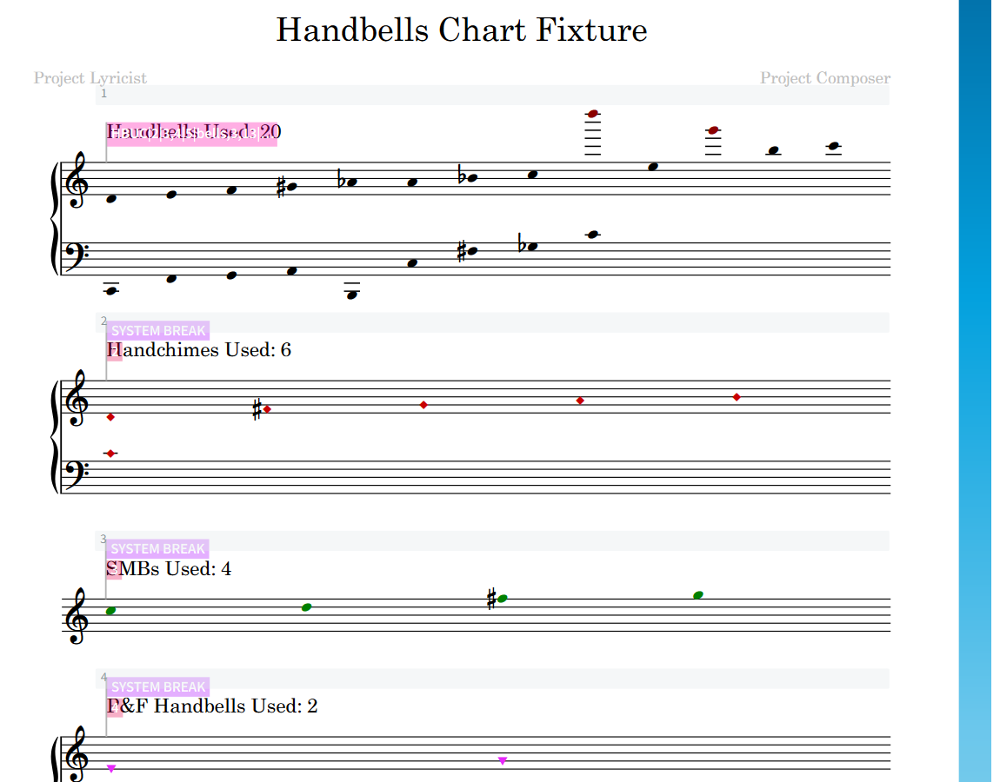
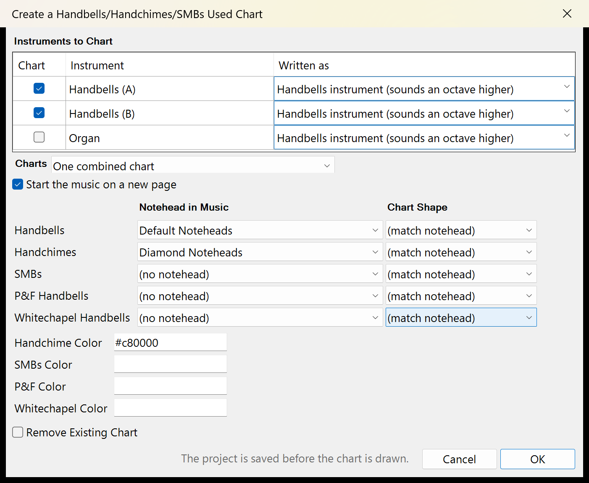

# Handbells Used Chart for Dorico

A Dorico 6 script plug-in, written in Lua, that draws "handbells used" charts at the start of a full score. It is a
port of the [Sibelius plugin](https://github.com/ThePrismSystem/handbells-used-chart-sibelius-plugin), and its
charts look the same. It handles handbells, handchimes, silver melody bells (SMBs), Petit & Fritsen bells and
Whitechapel bells, each charted separately.

- Bells are listed in pitch order. When a bell appears under two spellings (G#5 and Ab5, say), both spellings are
  charted, stacked in one column, so ringers can see where they share a bell. Natural signs are never drawn.
- Each kind of bell is told apart by its notehead. You choose in the dialog which notehead is which, from the
  noteheads the score uses.
- Chart notes have no stems. Each kind is drawn in the notehead shape its music uses, or in a shape you pick, and
  in its colour.
- Handbells, handchimes, P&F and Whitechapel bells are charted on grand staffs. SMBs are charted on a single treble
  staff, since there are no SMBs below C5.
- Bells above C7 share a column with the octave below, and bells below C3 with the octave above.
- One combined chart, or a separate chart for each instrument.
- Each instrument can be marked as written for Dorico's Handbells instrument, or written at pitch (a handbell part
  on a Piano or Organ staff). See [Written as](#written-as).
- Running the plug-in again replaces its chart. "Remove Existing Chart" takes it out. If the plug-in cannot
  positively identify a chart as one it made, it changes nothing and says why.



## Status

Version 0.1.0.

- **Windows:** tested with Dorico 6 Pro (6.2.30). The full test suite passes, including the tests that run inside
  Dorico on copies of a test project and of two of Steinberg's example projects.
- **Mac:** the Mac dialog is written but has not yet been run on a Mac. Version 1.0.0 follows its first run there.
- Any Dorico 6 build is accepted. If something goes wrong on a build other than 6.2.30, please
  [report it](https://github.com/ThePrismSystem/handbells-used-chart-dorico-plugin/issues).
- Charts in part layouts aren't supported yet. The chart is drawn in the full score only.

## Installation

Download the zip from the
[latest release](https://github.com/ThePrismSystem/handbells-used-chart-dorico-plugin/releases/latest). Copy
`Handbells Used Chart.lua` and the `Handbells Used Chart` folder into Dorico 6's Script Plug-ins folder, keeping
the two side by side.

On Windows:

```
C:\Users\<username>\AppData\Roaming\Steinberg\Dorico 6\Script Plug-ins\
```

On a Mac (in the Finder, choose Go > Go to Folder and paste the path):

```
~/Library/Application Support/Steinberg/Dorico 6/Script Plug-ins/
```

Create the `Script Plug-ins` folder if it isn't there, then restart Dorico. The plug-in appears as
**Script > Handbells Used Chart**.

There is nothing else to install. The dialog is drawn by Windows PowerShell on Windows, and by macOS's own
`osascript` (JavaScript for Automation) on a Mac, so it works on Apple silicon and Intel Macs alike.

[SECURITY.md](SECURITY.md) lists everything the plug-in runs and every file it uses, and shows how to check that a
download is genuine.

From a clone of this repository, `python tools/install.py` does the copying, and `python tools/install.py
--uninstall` removes exactly those two items again.

## Usage

1. Open the project and save it. The plug-in refuses a project that has never been saved.
2. Show the full score (not a part) and choose **Script > Handbells Used Chart**.
3. Choose the settings and click OK. Cancel changes nothing.

On OK, the plug-in saves the project first, so **File > Revert** takes the whole run back. It checks that the save
happened and stops if it didn't, where it can. On a Mac where Dorico doesn't give scripts its file library (the run
log says `lfs missing`), or for a file name with characters outside Windows' code page, it trusts the save. Then it
draws the chart into a new flow named "Handbells Used Chart" at the start of the project. That flow carries the
title on page 1, and the music starts on page 2. In a project with one flow, the music flow's own heading is hidden
so the title isn't printed twice. A results window then lists the sections drawn and anything skipped.

The section labels read "Handbells Used: _n_", "Handchimes Used: _n_", "SMBs Used: _n_", "P&F Handbells Used: _n_"
and "Whitechapel Handbells Used: _n_". With separate charts, each label starts with the instrument's name
("Handbells (B) - SMBs Used: 14"). The counts are physical bells, so a bell charted under two spellings counts
once. The labels are ordinary staff text, so you can edit them afterwards.

**Running it again** replaces the chart, so run it whenever the music changes.

**Removing the chart:** tick "Remove Existing Chart" and click OK. Dorico asks you to confirm deleting the chart's
flow. Then it opens its own "Delete Empty Players" dialog for the chart's players. That dialog lists every empty
player in the project, yours included, all ticked: untick any of your own before you click OK. Removing puts the
music flow's heading back.

## Settings



| Control               | Effect                                                                                                               |
| --------------------- | -------------------------------------------------------------------------------------------------------------------- |
| Instruments to Chart  | One row per player: tick the ones to chart, and set how each one's part is written                                  |
| Charts                | One combined chart, or a separate chart for each instrument. Only with two or more instruments ticked              |
| Notehead in Music     | One per kind of bell: which notehead in the score marks a handbell, handchime, SMB, P&F bell or Whitechapel bell    |
| Chart Shape           | One per kind: the shape its chart is drawn in, or `(match notehead)` to follow the notehead in the music          |
| Handchime Color       | The colour handchimes are charted in, as a hex value. Filled in from the music when you pick their notehead       |
| SMBs, P&F, Whitechapel Color | The same, for SMBs, P&F bells and Whitechapel bells. Handbells are always black                            |
| Remove Existing Chart | Removes the chart instead of drawing one                                                                           |

Your choices are remembered between runs and across projects.

### Choosing the instruments

The table lists every player in the project, apart from the chart's own. Two players with the same name are told
apart as `Handbells` and `Handbells (2)`. Only the ticked players are read, so a piano accompaniment written with
plain noteheads can be left out rather than charted as handbells. The players you leave out are remembered by name:
a piano left out of one project starts unticked in the next project that has a piano.

### Written as

A handbell sounds an octave above the written note. Dorico's own Handbells instrument already knows this. A handbell
part written on another instrument, such as a Piano or Organ staff, sounds as written, so its bells are an octave
above the notes Dorico plays back. The plug-in can't tell which kind of instrument a player has, so the table asks:

- **Handbells instrument (sounds an octave higher):** the default, for parts on Dorico's Handbells instrument.
- **At pitch (e.g. Piano or Organ):** for parts written on another instrument. Their bells are charted an octave
  higher.

The setting is remembered by player name, like the ticks.

### Choosing the noteheads

The notehead lists are filled from the open project each time: they hold the notehead sets the music uses, plus
`(no notehead)`, meaning that kind isn't in this piece. Handbells start on Default Noteheads and handchimes on
Diamond Noteheads wherever the music uses them. The others start on `(no notehead)` until you pick one. Your last
choice is remembered while the project still uses it.

Notes with a notehead none of the five lists names are skipped, and the results window counts them and names the
noteheads. Two kinds can't share a notehead: the plug-in says which one clashes and draws nothing.

### Colours

The colour fields take a six-digit hex value, with or without the `#` (`c80000`, `#C80000`). A blank field charts in
black, and so does anything that isn't six digits. When you pick a notehead, its kind's colour field takes the
colour most of that notehead's notes carry. You can type over it afterwards.

## Chart shapes

Each kind is drawn in one of seven shapes. `(match notehead)` uses the shape of the notehead the music uses for that
kind, so handchimes written as diamonds are charted as diamonds. Chart stems are hidden, so any notehead set charts
stemless.

| Shape             | Drawn with              | Dorico's notehead sets read as this shape                                                 |
| ----------------- | ----------------------- | ----------------------------------------------------------------------------------------- |
| Round             | Default Noteheads       | Default, Larger, Circled, Large Circled, Round White with Dot, and both Slashed sets       |
| Diamond           | Diamond Noteheads       | Diamond, White Diamond, Old-Style Diamond, Wide Diamond                                    |
| Square            | Rectangular Noteheads   | Rectangular                                                                               |
| Triangle          | Triangle Up Noteheads   | Triangle Up, Large Arrow Up, Triangle Left, Triangle Right                                 |
| Inverted triangle | Triangle Down Noteheads | Triangle Down, Large Arrow Down                                                            |
| Half circle       | (none in Dorico)        | Drawn round; the results window says so                                                    |
| Cone              | (none in Dorico)        | Drawn round; the results window says so                                                    |

A notehead set you made yourself is read by its name. A name containing inverted, triangle, diamond, square, half
circle, cone, normal, round or stemless gives that shape. When the shape can't be worked out, handchimes are charted
as diamonds, SMBs as squares, and everything else as round.

## Testing

For anyone building Dorico plug-ins, [docs/dorico-lua-guide.md](docs/dorico-lua-guide.md) explains how this one
works with Dorico's undocumented Lua scripting and the workarounds it needs.

- **Unit tests:** `python tools/run_tests.py` runs the Lua unit tests (stock Lua 5.2) and the Python tests. CI runs
  the same. The Mac dialog's tests need Node: they check `mac.js`'s syntax and run its non-AppKit parts.
- **Linting and security scans:** `python tools/lint.py` runs luacheck, PSScriptAnalyzer, ESLint, ruff, zizmor and
  gitleaks over the tracked files, and `--codeql` adds CodeQL. It says how to install any tool it can't find. CI runs
  the same checks.
- **The Windows dialog:** `python tests/dialog/test_windows_dialog.py` opens the real dialog and drives it.
- **Inside Dorico:** `python tools/run_tests.py --dorico` adds the suites that run in Dorico 6 through its Remote
  Control API, on scratch copies of `fixtures/handbells-fixture.dorico` and of Steinberg's example projects. Dorico
  must be running with Remote Control enabled. The run takes 40 to 50 minutes.

## Known limitations

- **Undo.** Edit > Undo after a run doesn't take the chart away cleanly. It takes back the chart's command edits
  together with your last action before the run, and leaves the chart's notes behind. Use **File > Revert**: the
  plug-in saved the project just before drawing.
- **Redo.** Reading the music clears Dorico's redo history, even when you then click Cancel. After a run that
  changed nothing, Edit > Redo brings back the temporary flow the plug-in read the music from: press Undo to take it
  away again.
- **The clipboard and selection.** Reading the music copies it, so a run replaces what was on the clipboard and
  changes the selection.
- **Delete Empty Players** (during Remove) lists your own empty players as well as the chart's, all ticked. Untick
  your own before you click OK, or Dorico deletes them too.
- The chart is alone on page 1, and the music starts on page 2.
- **Full-score options.** While a chart exists, the plug-in changes some of the full score's layout options:
  - Flow headings. With one music flow, they're turned off, so the title isn't printed twice. With several, only
    the chart's own heading is hidden: the music flows keep theirs, and the first gains one if it had none. Remove
    puts back the setting the project had.
  - The chart's staff labels are hidden through the full score's list of players to show by name, which the plug-in
    overwrites. Remove clears it.
  - "Hide empty staves" is set to all systems, with every music player always shown, so that each chart system shows
    only its own staves. Remove puts back Dorico's default (never), so a score that hid empty staves before loses
    that setting.
- The last chart section isn't stretched to the full width, because stretching it would also stretch the music's
  final system.
- A run that charts nothing leaves an existing chart as it was.
- Bells outside C2-C9 are skipped and reported. Grace notes are charted; cue notes aren't, since they repeat another
  player's music.
- Handbells are always charted in black.
- One notehead per kind of bell. Notes with a second notehead style for the same kind are skipped and counted.
- Tested on Windows only, until the first Mac check.

## Licence

GPL-3.0-only. See [LICENSE.md](LICENSE.md).
